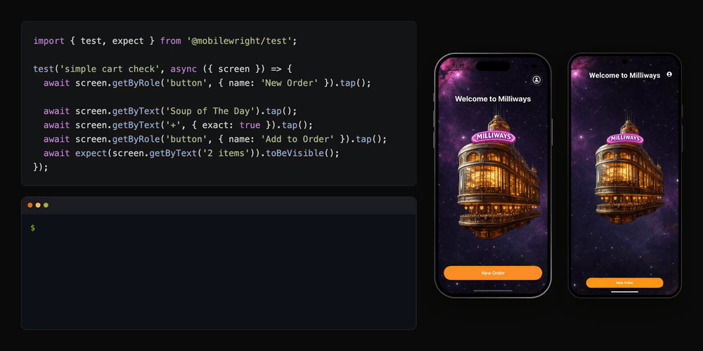
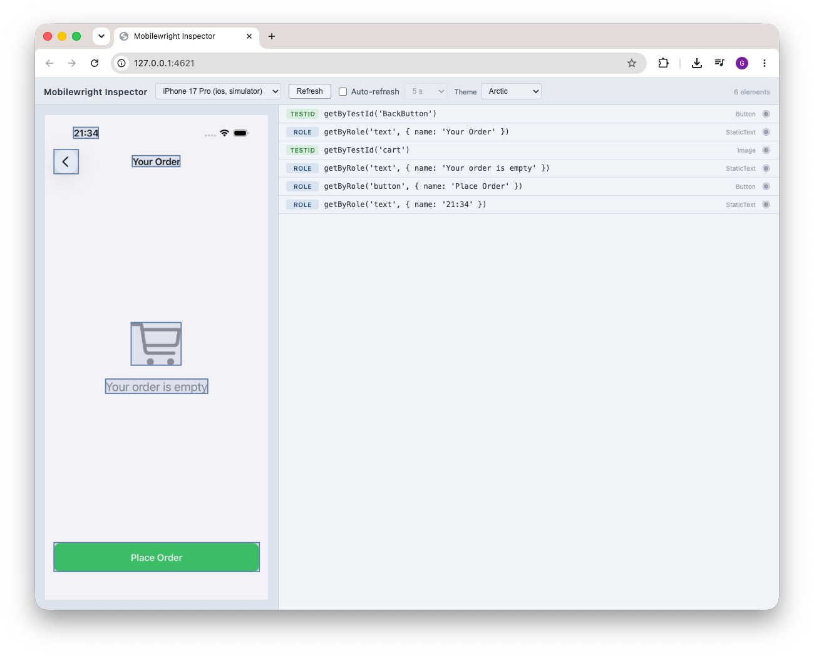

#  Mobilewright

[](https://www.npmjs.com/package/mobilewright)
[](LICENSE)
[](https://www.typescriptlang.org/)

**Mobilewright is a framework for mobile automation and testing.** Control iOS and Android devices, simulators, and emulators from tests, scripts, coding agents, and MCP clients, with a developer experience inspired by Playwright.

[Get Started](#get-started) · [API Examples](#api-at-a-glance) · [Documentation](https://mobilewright.dev/docs/) · [API Reference](#api-reference) · [Roadmap](ROADMAP.md) · [Mobile Next Cloud](https://mobilenext.ai/cloud?utm_source=github&utm_medium=readme&utm_campaign=mobilewright&utm_content=hero)

## Get Started

Choose the path that fits your workflow:

| | Best for | Install / start |
|---|---|---|
| [Mobilewright Test](#mobilewright-test) | End-to-end mobile testing | `npm init mobilewright@latest` |
| [Mobilewright CLI](#mobilewright-cli) | Coding agents and terminal automation | `npm install -g @mobilewright/cli@latest` |
| [Mobilewright MCP](#mobilewright-mcp) | AI agents using structured tools | `npx -y @mobilewright/mcp@latest` |
| [Mobilewright Library](#mobilewright-library) | Mobile automation scripts | `npm install mobilewright` |

## Prerequisites

All four workflows require **Node.js 22.12 or newer**. For local automation, have a booted simulator or emulator, or a connected device ready before you start:

- **iOS:** macOS with Xcode and the Command Line Tools. Boot an iOS simulator, or connect and trust a real iPhone.
- **Android:** a JDK and the Android SDK, with `ANDROID_HOME` set and `adb` on your `PATH`. Start an emulator, or connect a device with USB debugging enabled and authorized.
- **Your app:** install a build on the device and note its bundle ID (iOS) or package name (Android). The examples use `com.example.myapp`; replace it with your app's ID and adapt the labels and expected text to your app.

Check your local environment and available devices:

```bash
npx mobilewright doctor
npx mobilewright devices
```

Mobilewright includes [mobilecli](https://github.com/mobile-next/mobilecli) for local device control. The `doctor` command reports missing dependencies and how to fix them.

For a real iPhone, install the device agent using a development provisioning profile that includes your device and a matching signing certificate with its private key in your Mac's keychain:

```bash
npx mobilewright install --device <device-id> --provisioning-profile /path/to/profile.mobileprovision
```

Replace `<device-id>` with the ID from `devices` and the profile path with your own. See [mobilecli setup](https://github.com/mobile-next/mobilecli) for signing requirements.

See [Installation](https://mobilewright.dev/docs/), [Windows setup](https://mobilewright.dev/docs/getting-started/windows), [Android in Docker](https://mobilewright.dev/docs/guides/docker), and [Troubleshooting](https://mobilewright.dev/docs/guides/troubleshooting) for platform-specific instructions. Tests and library scripts can also use [cloud device providers](#run-on-real-devices-in-the-cloud); MCP supports [Mobile Next Cloud](https://github.com/mobile-next/mobile-mcp) without a local device toolchain.

## Mobilewright Test

Write repeatable end-to-end tests with `@mobilewright/test`, which extends Playwright Test with mobile `device` and `screen` fixtures, auto-waiting locators, retrying assertions, and test reports.

### Install

Scaffold a project:

```bash
npm init mobilewright@latest
```

Or add Mobilewright to an existing Node.js project:

```bash
npm install --save-dev mobilewright @mobilewright/test
npx mobilewright init
```

### Configure your app

Edit the generated `mobilewright.config.ts` (or `mobilewright.config.js` if you chose JavaScript):

```typescript
import { defineConfig } from 'mobilewright';

export default defineConfig({
  platform: 'ios',
  bundleId: 'com.example.myapp',
  deviceName: /iPhone/,
  timeout: 30_000,
});
```

For Android, set `platform: 'android'` and change or remove `deviceName`. You can also select a specific device with `deviceId`. The app must already be installed, or you can add `installApps` with the path to a compatible build, such as an Android `.apk` or a real-device iOS `.ipa`.

### Write a test

Replace the generated example test with this sign-in flow. Use your app's field labels, a test account, and the text shown after a successful sign-in:

```typescript
import { test, expect } from '@mobilewright/test';

test('can sign in', async ({ screen }) => {
  await screen.getByLabel('Email').fill('user@example.com');
  await screen.getByLabel('Password').fill('password123');
  await screen.getByRole('button', { name: 'Sign In' }).tap();

  await expect(screen.getByText('Welcome back')).toBeVisible();
});
```

The fixtures connect to the configured device, restart the configured app before each test by default, and close the connection when the worker finishes. A screenshot is attached to the report when a test fails.

### Run tests

```bash
npx mobilewright test
```

Generate and open an HTML report:

```bash
npx mobilewright test --reporter html
npx mobilewright show-report
```



[Writing tests](https://mobilewright.dev/docs/getting-started/writing-tests) · [Running tests](https://mobilewright.dev/docs/getting-started/running-tests) · [Configuration](https://mobilewright.dev/docs/test/configuration) · [Fixtures](https://mobilewright.dev/docs/test/fixtures) · [CI setup](https://mobilewright.dev/docs/getting-started/ci)

## Mobilewright CLI

`mobilewright-cli` lets coding agents such as Claude Code, Codex, and Cursor control mobile devices through shell commands. It returns compact accessibility snapshots with element references, and prints the corresponding Mobilewright code after actions so an explored flow can become a test.

### Install

```bash
npm install -g @mobilewright/cli@latest
```

Optionally install the bundled agent skill in your project. For Claude Code:

```bash
mobilewright-cli install
```

For agents that discover skills in `.agents/skills/`:

```bash
mobilewright-cli install --skills agents
```

### Use from the terminal

List devices, launch your installed app, and read the screen:

```bash
mobilewright-cli devices
mobilewright-cli --device <device-id> launch com.example.myapp
mobilewright-cli snapshot
```

Replace `<device-id>` with an ID from `devices`. The CLI remembers it for later commands; when exactly one device is online, you can omit `--device`.

A sign-in screen might look like this:

```text
- textfield "Email" [ref=e7]
- textfield "Password" [ref=e8]
- button "Sign In" [ref=e9]
```

Use the references from your own snapshot to interact:

```bash
mobilewright-cli fill e7 "user@example.com"
mobilewright-cli fill e8 "password123"
mobilewright-cli tap e9
mobilewright-cli expect visible --text "Welcome back"
mobilewright-cli screenshot -o welcome.png
```

References can change as the screen changes. Read the fresh snapshot after each action and use its current refs in the next command; `e7`, `e8`, and `e9` above are illustrative. To install a build first, use `mobilewright-cli app-install ./builds/myapp.apk` with the appropriate file for your device.

### Use with a coding agent

```text
Use mobilewright-cli to explore the sign-in flow in com.example.myapp
on my connected device. Ask me for test credentials, verify that the
welcome screen appears, and save a screenshot. Then write the flow as
a Mobilewright test.
```

[Full CLI documentation](https://mobilewright.dev/docs/agent-cli/introduction) covers commands, device selection, named sessions, JSON output, and skill installation.

## Mobilewright MCP

Mobilewright MCP gives AI agents device control through the Model Context Protocol. The `@mobilewright/mcp` package provides the [Mobile MCP server](https://github.com/mobile-next/mobile-mcp), with tools for device discovery, app installation, accessibility inspection, gestures, screenshots, and more.

### Configure your MCP client

Add this to a client that uses `mcpServers` configuration, such as Claude Desktop or Cursor:

```json
{
  "mcpServers": {
    "mobilewright": {
      "command": "npx",
      "args": ["-y", "@mobilewright/mcp@latest"]
    }
  }
}
```

Your MCP client starts the server using this command. Reconnect or restart the client after saving the configuration. Clients with a different configuration format can register the same command and arguments; see the [client setup guide](https://github.com/mobile-next/mobile-mcp#installation-and-configuration).

### Try it

First ask your agent:

```text
List the available mobile devices
```

Once your device appears, try an app workflow:

```text
Open com.example.myapp on my connected device. Inspect the sign-in screen,
ask me for test credentials, and sign in. Verify that the welcome screen
appears and save a screenshot.
```

The agent reads the device's accessibility elements to understand the screen and act on it. Screenshots and coordinate actions are also available when needed. You can then ask it to turn the flow into a repeatable Mobilewright test.

[MCP tools and setup](https://github.com/mobile-next/mobile-mcp) · [From an agent session to a CI test](https://mobilewright.dev/docs/guides/mobile-mcp)

## Mobilewright Library

Use `mobilewright` directly in JavaScript or TypeScript scripts to automate apps, capture screenshots, and control devices.

### Install

```bash
npm install mobilewright
```

### Write a script

Save this as `sign-in.mjs`. It connects to an available iOS device, launches your installed app, signs in, and saves a screenshot:

```javascript
import { ios, expect } from 'mobilewright';

const device = await ios.launch({ bundleId: 'com.example.myapp' });

try {
  const screen = device.screen;
  await screen.getByLabel('Email').fill('user@example.com');
  await screen.getByLabel('Password').fill('password123');
  await screen.getByRole('button', { name: 'Sign In' }).tap();
  await expect(screen.getByText('Welcome back')).toBeVisible();
  await screen.screenshot({ path: 'welcome.png' });
} finally {
  await device.close();
}
```

Replace the app ID, credentials, and locators with your app's values, then run:

```bash
node sign-in.mjs
```

For Android, import `android` and use `android.launch(...)`. Pass `deviceId` or a `deviceName` regular expression to choose a device, or `installApps` to install a build before launching. Library scripts pass these options directly to `launch()`.

[Locators](https://mobilewright.dev/docs/guides/locators) · [Actions](https://mobilewright.dev/docs/guides/actions) · [Assertions](https://mobilewright.dev/docs/guides/assertions) · [Screenshots](https://mobilewright.dev/docs/guides/screenshots)

## Features

- **iOS and Android** — automate native and hybrid apps on simulators, emulators, and real devices.
- **Playwright-style API** — `screen.getByRole('button').tap()`, chainable locators, and `expect` assertions.
- **Auto-waiting** — locator actions wait for elements to be actionable; assertions retry until satisfied or timed out.
- **Agent workflows** — use the CLI for shell-based agents or MCP for agents that call structured tools.
- **WebViews** — access embedded web content with a Playwright-compatible Page and Locator API.
- **Developer tools** — explore screens with Inspector, record tests with Codegen, and inspect results in HTML reports.
- **Remote devices** — connect to mobilecli on another machine or use a supported cloud provider.

## API at a glance

These are independent examples to use inside a test or library script. In tests, use the `screen` and `device` fixtures and import `expect` from `@mobilewright/test`. In scripts, use `device.screen` and import `expect` from `mobilewright`, as in the [library quick start](#mobilewright-library).

### Locators

Find native elements by what users see or by an accessibility identifier:

```typescript
screen.getByText('Welcome', { exact: true });       // exact text
screen.getByText(/welcome/i);                      // case-insensitive RegExp match
screen.getByText('welcome', { exact: false });      // substring match
screen.getByLabel('Email');                        // accessibility label
screen.getByTestId('login-button');                // accessibility identifier
screen.getByRole('button', { name: 'Sign In' });    // semantic role and name
screen.getByRole('button', { name: /sign in/i });   // role with a RegExp name
screen.getByPlaceholder('Search...');              // placeholder text
```

Locators are lazy: creating one does not query the device. Chain and filter them to narrow a match:

```typescript
const cartItem = screen.getByRole('listitem').filter({ hasText: 'Milk' });
await cartItem.getByRole('button', { name: 'Remove' }).tap();

const items = screen.getByRole('listitem');
const count = await items.count();                 // current number of matches
await items.nth(1).tap();                          // second item, zero-based
```

### Actions and assertions

Locator actions wait for elements to be visible, enabled, and stable before interacting:

```typescript
await screen.getByLabel('Email').fill('user@example.com');
await screen.getByLabel('Search').clear();
await screen.getByRole('button', { name: 'Continue' }).tap();
await screen.getByRole('switch', { name: 'Notifications' }).check();
await screen.getByTestId('photo').doubleTap();
await screen.getByText('Message').longPress({ duration: 1000 });
await screen.getByTestId('carousel').swipe({ direction: 'left' });
await screen.getByText('Terms of service').scrollIntoViewIfNeeded();
```

Assertions retry until the condition is met or the timeout expires:

```typescript
await expect(screen.getByText(/welcome/i)).toBeVisible();
await expect(screen.getByText('Loading')).not.toBeVisible();
await expect(screen.getByRole('button', { name: 'Continue' })).toBeEnabled();
await expect(screen.getByRole('switch', { name: 'Notifications' })).toBeChecked();
await expect(screen.getByTestId('status')).toHaveText(/ready/i);
await expect(screen.getByLabel('Email')).toHaveValue('user@example.com');
await expect(screen.getByRole('listitem')).toHaveCount(3);
```

### Device lifecycle and screenshots

Control the app, open deep links, and capture the screen through the connected device:

```typescript
await device.terminateApp('com.example.myapp');
await device.launchApp('com.example.myapp');
await device.openUrl('myapp://settings');
await device.setOrientation('landscape');

await screen.screenshot({ path: 'screenshots/settings.png' });
await screen.screenshot({ path: 'screenshots/settings.jpg', format: 'jpeg', quality: 80 });
const image = await screen.getByTestId('profile-card').screenshot(); // cropped PNG Buffer
const size = await device.screenSize();            // { width, height, scale }
```

In standalone scripts, call `device.close()` in a `finally` block, as shown in the [library example](#mobilewright-library). Test fixtures manage the connection for you. Device capabilities, such as orientation and deep links, depend on the platform and driver.

### WebViews

For a hybrid app, navigate to a screen containing an embedded WebView in a debug/development build, then use its Playwright-compatible Page and Locator APIs:

```typescript
const page = await screen.getByWebView().page();

await page.getByLabel('Email').fill('user@example.com');
await page.getByRole('button', { name: 'Sign In' }).click();
await expect(page).toHaveURL(/dashboard/);
await expect(page.getByRole('heading', { name: 'Welcome' })).toBeVisible();
```

Use `screen.getByWebView({ testId: 'checkout' })` to select a particular WebView. See the [WebViews guide](https://mobilewright.dev/docs/guides/webviews) for platform requirements, frames, navigation, and real touch input.

## API Reference

Tests and library scripts share the same device, screen, locator, and assertion APIs. Start with these guides:

| API / topic | Documentation |
|---|---|
| `screen.getByRole()`, `getByLabel()`, `getByText()`, `getByTestId()` | [Locators and platform mappings](https://mobilewright.dev/docs/guides/locators) |
| `locator.tap()`, `fill()`, `swipe()`, and device actions | [Actions](https://mobilewright.dev/docs/guides/actions) |
| `expect(locator)` and retrying assertions | [Assertions](https://mobilewright.dev/docs/guides/assertions) |
| Actionability and explicit waits | [Auto-waiting](https://mobilewright.dev/docs/guides/auto-waiting) |
| `screen.screenshot()` and screenshot files | [Screenshots](https://mobilewright.dev/docs/guides/screenshots) |
| `screen.getByWebView().page()` and web locators | [WebViews](https://mobilewright.dev/docs/guides/webviews) |
| Device URLs, dialogs, and location | [Deep links](https://mobilewright.dev/docs/guides/deep-links), [Dialogs](https://mobilewright.dev/docs/guides/dialogs), [Geolocation](https://mobilewright.dev/docs/guides/geolocation) |
| `defineConfig()` and test options | [Configuration](https://mobilewright.dev/docs/test/configuration) |
| `test`, `device`, `screen`, and `test.use()` | [Test fixtures](https://mobilewright.dev/docs/test/fixtures) |
| Multiple devices, retries, and CI distribution | [Projects](https://mobilewright.dev/docs/test/projects), [Retries](https://mobilewright.dev/docs/test/retries), [Sharding](https://mobilewright.dev/docs/test/sharding) |

## Test and utility commands

The `mobilewright` executable ships with the library and provides test running, setup, and debugging tools. The separate [`mobilewright-cli`](#mobilewright-cli) executable provides interactive commands for coding agents.

| Command | Purpose |
|---|---|
| `npx mobilewright init` | Create a configuration and example test; skip files that already exist |
| `npx mobilewright doctor` | Check the local environment and report missing dependencies |
| `npx mobilewright devices` | List devices, simulators, and emulators |
| `npx mobilewright install` | Install the mobilecli device agent |
| `npx mobilewright test` | Run tests using your Mobilewright configuration |
| `npx mobilewright show-report` | Open an HTML test report |
| `npx mobilewright merge-reports ./blob-reports` | Combine reports from sharded runs |
| `npx mobilewright screenshot -o home.png` | Save a device screenshot |
| `npx mobilewright inspect` | Explore a device and find locators |
| `npx mobilewright codegen` | Record device interactions as test code |

See the [command reference](https://mobilewright.dev/docs/test/cli) for options, test filtering, reporters, and parallel execution.

### Inspector

```bash
npx mobilewright inspect
```

The Inspector opens in your browser with a live device screenshot and element locators. Choose a device, inspect its elements, and copy locators for your tests or scripts.



[Inspector guide](https://mobilewright.dev/docs/guides/inspector)

### Codegen

```bash
npx mobilewright codegen
```

Interact with your device from the browser while Codegen records taps, gestures, and assertions as test code.

[Codegen guide](https://mobilewright.dev/docs/guides/codegen)

## Packages

| Package | Description |
|---|---|
| `mobilewright` | Library with `ios` and `android` launchers, `expect`, configuration, and the `mobilewright` test and utility commands |
| `@mobilewright/test` | Playwright Test integration with mobile fixtures and assertions |
| `@mobilewright/cli` | The `mobilewright-cli` executable and bundled skill for coding agents |
| `@mobilewright/mcp` | MCP server entry point powered by Mobile MCP |
| `@mobilewright/core` | `Device`, `Screen`, `Locator`, and assertion implementations |
| `@mobilewright/protocol` | Shared TypeScript driver interfaces and types |
| `@mobilewright/driver-mobilecli` | Driver for local and remote mobilecli devices |
| `@mobilewright/driver-mobilenext` | Driver for [Mobile Next Cloud](https://mobilenext.ai/cloud?utm_source=github&utm_medium=readme&utm_campaign=mobilewright&utm_content=packages) devices |

Install the package for your chosen workflow from [Get Started](#get-started). The core and local driver packages are included as dependencies where needed.

## Why Mobilewright?

If you've used Playwright, you already know Mobilewright.

| | Mobilewright | Appium | Detox | XCTest/Espresso |
|---|---|---|---|---|
| API style | Playwright (`getByRole`, `expect`) | Selenium (WebDriver) | Custom | Native framework |
| Auto-wait | Built-in, every action | Manual waits | Partial | Manual |
| Setup | `npm install mobilewright` | Server + drivers + caps | React Native only | Xcode/AS only |
| Cross-platform | iOS + Android, one API | Yes, verbose | React Native only | Single platform |
| AI agent support | First-class (accessibility tree) | Limited | No | No |
| Real devices in the cloud | [Mobile Next Cloud](https://mobilenext.ai/cloud?utm_source=github&utm_medium=readme&utm_campaign=mobilewright&utm_content=comparison), [BrowserStack](https://mobilewright.dev/docs/cloud-providers/browserstack), [Sauce Labs](https://mobilewright.dev/docs/cloud-providers/saucelabs), [TestMu AI](https://mobilewright.dev/docs/cloud-providers/testmu), [TestingBot](https://mobilewright.dev/docs/cloud-providers/testingbot) | Yes (complex) | Simulators only | Yes |
| Locators | Semantic roles + labels | XPath, CSS, ID | Test IDs | Native queries |

## Run on real devices in the cloud

The same tests that run on a local device run on real devices in the cloud. Only the `driver` in `mobilewright.config.ts` changes. Mobilewright supports these device clouds:

- **[Mobile Next Cloud](https://mobilenext.ai/cloud?utm_source=github&utm_medium=readme&utm_campaign=mobilewright&utm_content=cloud-section)**, built by the Mobilewright team. API access to hundreds of real Android and iOS devices, with test results uploaded to your dashboard automatically. [Setup guide](https://mobilewright.dev/docs/cloud-providers/mobile-next-cloud)
- **[BrowserStack](https://mobilewright.dev/docs/cloud-providers/browserstack)**, App Automate sessions via the `@browserstack/mobilewright` driver
- **[Sauce Labs](https://mobilewright.dev/docs/cloud-providers/saucelabs)**, real Android and iOS devices via the `@saucelabs/mobilewright-driver` package
- **[TestMu AI](https://mobilewright.dev/docs/cloud-providers/testmu)**, real Android and iOS devices via the `@testmuai/mobilewright` driver
- **[TestingBot](https://mobilewright.dev/docs/cloud-providers/testingbot)**, real devices, emulators and simulators via the `@testingbot/mobilewright-driver` package

## Telemetry

Mobilewright collects anonymous usage telemetry via PostHog and Scarf. To disable it, set the standard [`DO_NOT_TRACK`](https://consoledonottrack.com) environment variable:

```bash
DO_NOT_TRACK=1 npx mobilewright test
```

To opt out permanently, set `export DO_NOT_TRACK=1` in your shell profile (for example `~/.zshrc` or `~/.bashrc`) or set `DO_NOT_TRACK=1` in your CI environment.

When telemetry is enabled, a random identifier is generated and stored in `~/.config/mobilenext/mobilewright/config.json`. Mobilewright never sends personal information or test data. The Scarf pixel is a plain HTTP request, so Scarf receives the usual request metadata (source IP, user agent); Scarf states it does not retain raw IP addresses. Setting `MOBILEWRIGHT_DISABLE_TELEMETRY` (any value) or `DO_NOT_TRACK` (any value except `0` or `false`) opts out of both.

For Mobilewright MCP, set `MOBILEMCP_DISABLE_TELEMETRY=1` in the MCP server's environment. See [MCP telemetry configuration](https://github.com/mobile-next/mobile-mcp#telemetry) for the client configuration example.

## Contributing

See [CONTRIBUTING.md](CONTRIBUTING.md) for development setup, reporting issues, and submitting changes.

## Framework Support

| Framework | iOS | Android | Notes |
|---|---|---|---|
| UIKit / Storyboards | ✅ | — | Full native element types, all locators work |
| SwiftUI | ✅ | — | Maps to standard `XCUIElementType` accessibility tree |
| Jetpack Compose | — | ✅ | Renders to native Android accessibility nodes |
| Android Views (XML layouts) | — | ✅ | Full native element types, all locators work |
| React Native | ✅ | ✅ | Uses real native components; RN-specific types mapped to roles |
| Expo | ✅ | ✅ | Same as React Native (Expo builds to RN) |
| Flutter | ✅ | ✅ | Must be a debug build for full support |
| .NET MAUI | ✅ | ✅ | Compiles to native controls on both platforms |
| Kotlin Multiplatform (shared UI) | ⏳ | ✅ | Android native works; iOS Compose Multiplatform support in progress |
| Cordova / Capacitor | ✅ | ✅ | WebView content accessible via native accessibility tree |
| NativeScript | ✅ | ✅ | Renders to native views on both platforms |

## License

This project is licensed under the Apache License 2.0 — see the [LICENSE](LICENSE) file for details.

