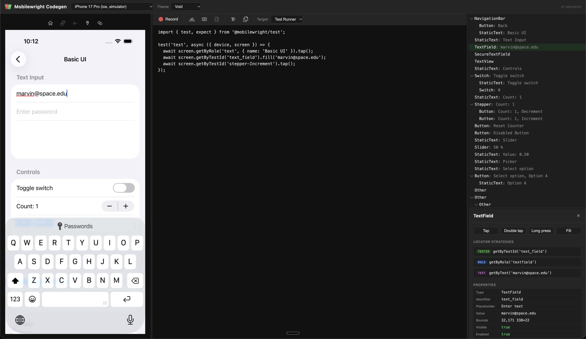

# Codegen

Codegen records what you do on a connected device and writes it as a Mobilewright
test. Click on a live screenshot of the device, and each action is sent to the device
and added to the test as a line of code, using the same locators the
[Inspector](./inspector) recommends.



## Start recording

```bash
npx mobilewright codegen
```

Codegen starts a local server on a random free port and opens it in your browser. The
URL is also printed in the terminal, so you can open it yourself if the browser does not
start:

```
Mobilewright Codegen running at http://127.0.0.1:53817/codegen
```

Use `--port` (or `-p`) to pin a specific port instead:

```bash
npx mobilewright codegen --port 8080
```

Pick a device from the selector at the top. It lists every simulator, emulator and
real device Mobilewright can reach, and refreshes every few seconds, so a device you
boot after starting codegen shows up on its own. The device screen appears on the left
and the test in the middle, starting from:

```ts
import { test, expect } from '@mobilewright/test';

test('test', async ({ device, screen }) => {
});
```

The screenshot refreshes continuously while the page is open.

## Recording actions

Hover over the screenshot to see which element a click will target, then click it.
Codegen taps that element on the device and adds a line to the test:

```ts
await screen.getByRole('button', { name: 'Sign in' }).tap();
```

Locators follow the Inspector's priority (`getByTestId` > `getByRole` > `getByLabel` > `getByText`).
When a locator matches more than one element, codegen adds `.nth()` so the test taps the
same one. Where no element has a usable locator, the click is
recorded by coordinates:

```ts
await screen.tap(201, 437);
```

Toggle **Record** to keep using the device without adding code.

If an action fails on the device, codegen shows the error for a few seconds and does
not add the line, so the test only contains steps that worked.

## Filling text fields

Select a text field in the [view tree](#view-tree) and click **Fill**. Enter the text and
codegen taps the field, clears it and types the text, the same steps `fill()` takes in a
test:

```ts
await screen.getByTestId('text_field').fill('marvin@space.edu');
```

**Fill** is enabled only for elements that accept text input.

## Device buttons, location and URLs

The buttons above the device screen press **Home**, **App switch** and **Back**
(App switch and Back are Android only), **Set location** overrides the device's
GPS location, and **Open URL** opens a web link or a deep link on the device. Each one
is recorded:

```ts
await screen.pressButton('HOME');
await device.setGeolocation({ latitude: -17.833, longitude: 177.947 });
await device.setGeolocation(null); // Reset location
await device.openUrl('myapp://orders/42');
```

## Assertions

Click **Assert text** or **Assert value** in the toolbar, then click an element. Codegen
adds an assertion with the element's current text or value instead of tapping it:

```ts
await expect(screen.getByText('Welcome back')).toHaveText('Welcome back');
await expect(screen.getByLabel('Email')).toHaveValue('user@example.com');
```

## View tree

The **View tree** button opens the element hierarchy on the right. Hover over a row to
highlight the element on the screenshot, and click it to see its locators and
properties. To find an element without scrolling the tree, **Shift-click** it on the
screenshot: the tree opens, expands and selects it, and nothing is sent to the device.

From the details, **Tap**, **Double tap** and **Long press** perform that gesture on the
device and record it, and **Fill** [types into a text field](#filling-text-fields):

```ts
await screen.getByTestId('photo').doubleTap();
await screen.getByRole('listitem', { name: 'Inbox' }).longPress();
```

## Test runner or library

The **Target** selector chooses what the recorded steps are wrapped in. **Test Runner**,
the default, writes a test for `npx mobilewright test`, as shown above. **Library** writes
a standalone script that launches the device itself, for the platform of the selected
device:

```ts
import { ios, expect } from 'mobilewright';

const device = await ios.launch();
const { screen } = device;

await screen.getByTestId('text_field').fill('marvin@space.edu');
await device.close();
```

The recorded steps are the same for both. Codegen remembers your choice for next time.

## Editing the code

The code is editable. New steps are inserted before the end of the test, so changes you
make by hand are kept while you keep recording. Switching **Target** rebuilds the code
from the recorded steps, which discards hand edits.

## Stopping codegen

Click **Copy** in the toolbar to copy the code to the clipboard, then press `Ctrl+C` in
the terminal. Codegen disconnects from the device and shuts the server down.

The **Theme** selector in the header only changes the colors of the codegen page.
